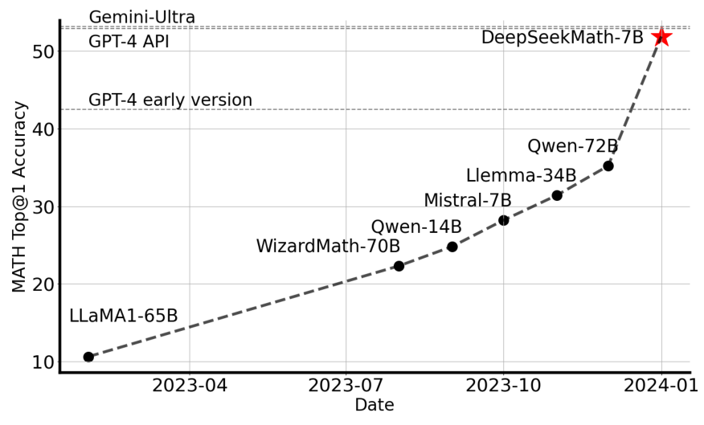
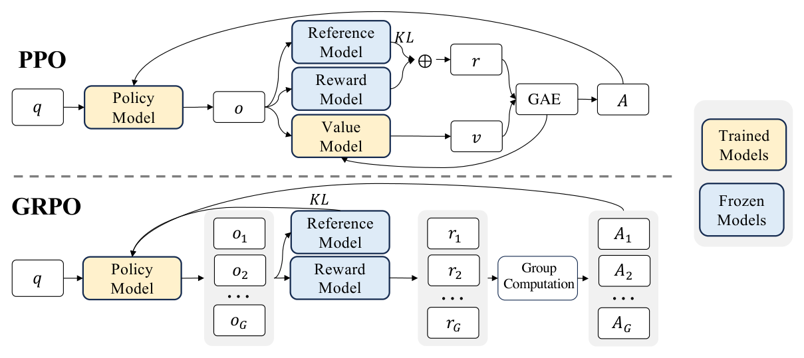
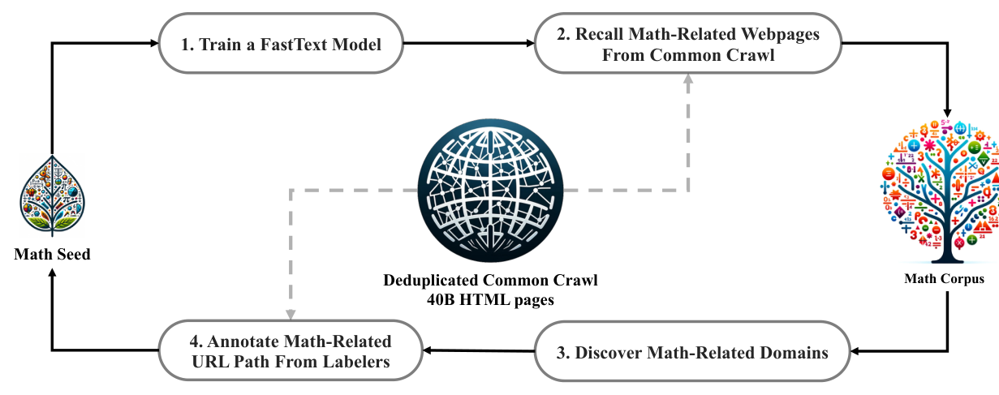
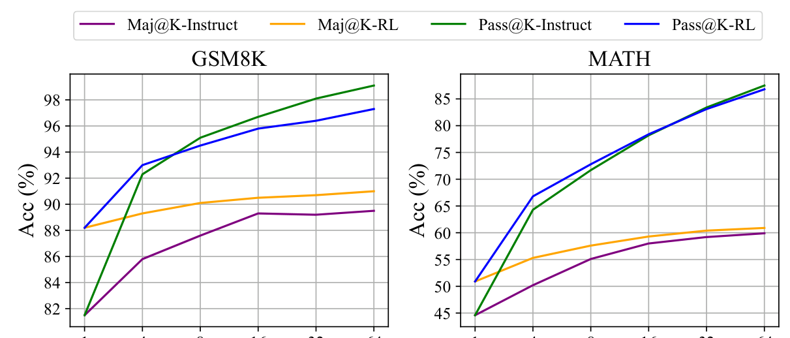

# DeepSeekMath（全称：DeepSeekMath: Pushing the Limits of Mathematical Reasoning in Open Language Models）

> **一句话本质**：DeepSeekMath 用数学数据预训练、监督微调和 GRPO 提升数学推理；GRPO 用同题多次作答的相对奖励代替独立 Critic。
>
> 作者/机构：Zhihong Shao, Peiyi Wang, Qihao Zhu, Runxin Xu, Junxiao Song 等 ｜ DeepSeek-AI, 清华大学, 北京大学 ｜ 年份：2024 ｜ 原文：Zotero 锚点（见下行）或 [arXiv:2402.03300](http://arxiv.org/abs/2402.03300) ｜ 入库：2026-09-18
> Zotero：[shaoDeepSeekMathPushingLimits2024](zotero://select/items/@shaoDeepSeekMathPushingLimits2024) `shaoDeepSeekMathPushingLimits2024` ｜ [XQHXBPT7](zotero://select/items/XQHXBPT7) `XQHXBPT7` ｜ [DOI](https://doi.org/10.48550/arXiv.2402.03300) `10.48550/arXiv.2402.03300`

## 五分钟重建

  
PPO 通常用 Critic 估计价值基线。大语言模型再配一套价值网络，会增加显存和训练成本。GRPO 改用同一道题的一组回答作为比较基线。

  <ol class="guide-path" aria-label="机制路径">
    <li><h3>同题多次作答</h3>
从旧策略采样一组回答，给每条回答打奖励分。
</li>
    <li><h3>组内比较</h3>
用奖励减去组均值，再按组标准差归一化，得到相对优势。GRPO 因此省去独立 Critic。
</li>
    <li><h3>更新生成概率</h3>
优势进入裁剪策略目标。参考模型的 KL 正则单独保留。
</li>
  </ol>
  
<strong>具体例子（教学假设）</strong>：同题四个回答的奖励是 [1,1,0,0]。均值为 0.5，标准差为 0.5。忽略稳定除数后，优势是 [+1,+1,-1,-1]。这里比较的是奖励差，不只是名次。

  
<strong>边界</strong>：省掉 Critic 不等于总显存必定减半。论文中 Pass@K 的观察也只支持其特定实验下的概率重分配解释，不能证明所有 RL 都无法扩展解题能力。

  

    <h3>换个条件看机制</h3>
    
四条回答全得 1 分时，组相对优势是什么？是不是整个训练目标都没有梯度？

    
组相对优势全为零，策略 surrogate 部分没有这组回答的区分信号。KL 正则仍可能产生梯度，所以不能把两者混为一谈。

  

  <aside class="guide-selftest"><h3>可选自测</h3>
关掉提示后解释：GRPO 去掉了哪个模型？如果奖励模型还在，为什么这不矛盾？
</aside>
  
2026-10-04：当日未进行理解检验。2026-10-25：实际复测中用角色对照、终止步骤数值例子与低概率反例补讲；提示后复验已收敛，PPO 机制与证据边界仍待下次独立复测。

## 论文图解

*图 1 费曼图解（论文 Figure 1）：无需外部工具与复杂投票，DeepSeekMath 7B 仅凭模型自身推理在竞赛级 MATH 上达到 51.7%，一举逼近闭源的 Gemini-Ultra 和 GPT-4，大幅拉开与以往开源模型的差距。*

## 解决什么问题

大语言模型在数学与长链逻辑推理上长期面临两大结构性瓶颈：

1. **预训练数据来源的误区与偏见**：
   - 传统观念普遍认为数学推理能力主要来自形式化论文（如 arXiv LaTeX 源码）或高成本合成数据，而通用互联网网页（如 Common Crawl）充满噪声、缺乏深度；
   - 但事实上单纯堆砌 arXiv 论文在 GSM8K、MATH、MMLU-STEM 等测试上提升极小甚至出现能力退化（arXiv 格式高度浓缩、符号繁复且缺少由浅入深的解题推导与讨论）；且现有高质量数学预训练集规模严重受限（如 Minerva 网页数据仅约 17B tokens）。
2. **强化学习（PPO）在大模型推理对齐时的资源与估计瓶颈**：
   - **显存开销巨大**：传统 [PPO](2017-ppo.md) 是典型的 Actor-Critic 结构，除了策略模型（Actor）和参考模型（Ref），还必须在显存中维护一个同等参数量级的价值模型（Critic），增加显存和训练成本，限制了模型尺寸与上下文长度；具体成本取决于模型共享、卸载与训练实现；
   - **稀疏奖励与逐 token 价值估计的矛盾**：数学题通常只有在完整推导结束时才能检验最终答案的对错（Outcome Supervision）。让 Critic 模型去预测长链推理中每一个中间 token 的绝对期望收益 $V(s_t)$，不仅拟合极其困难，而且估计方差巨大、噪声极高；
   - **离线微调（RFT / DPO）缺乏动态探索与惩罚机制**：拒绝采样微调（RFT）只挑选旧模型碰巧做对的样本做 SFT，不仅无法惩罚做错的路径，而且脱离了模型参数更新后的在线探索；DPO 则难以处理多步复杂推理中的动态长轨迹探索。

## 大白话讲解

### 类比：开除特聘名师，改成班级自评

- **传统 PPO 的做法**：请了一位极其昂贵的特聘名师（Critic 价值模型）。学生（Actor）每写下一个公式、每推导一步，名师都必须在旁边打一个绝对预估分（估算当前状态的长期期望回报 $V(s_t)$）。
  - **痛点**：雇名师的开销（显存）跟学生自己一样大；而且题目还没做完前，名师往往也只能瞎猜，打出来的中间分噪声极大，反而带偏了学生。
- **GRPO 的做法**：**把特聘名师直接开除**。面对同一道数学难题，让学生自己连续做 64 遍（生成 $G=64$ 份不同的解题草稿）。
  - 做完后，判卷人（规则或奖励模型）给每份草稿评一个最终分数。
  - 计算这 64 份草稿的**平均分**与**标准差**；
  - 高于平均分的草稿算「优秀变体」，赋予正优势值（向此轨迹学习）；低于平均分的草稿算「劣质变体」，赋予负优势值（抑制该推导路径）；
  - 用组内相对奖励代替独立价值基线，省去独立 Critic 的成本，并以组内相对奖励减少对绝对价值基线的依赖；总体显存收益取决于实现，奖励噪声仍会保留。

*图 2 费曼图解（论文 Figure 4）：PPO（左）需要同时加载策略、参考、奖励以及庞大的价值模型（Value Model），通过 GAE 逐 token 计算优势；GRPO（右）彻底丢弃价值模型，同一个问题采样 $G$ 个候选回答，利用组内平均与标准差归一化直接得到相对优势，省去独立价值网络的成本；总体显存收益取决于实现。*

## 关键机制

### 1. 从 PPO 到 GRPO 的目标函数重构

传统 [PPO](2017-ppo.md) 将 token 级的 KL 散度直接塞入奖励函数中（$r_t - \beta \log \frac{\pi_\theta}{\pi_{ref}}$），导致价值模型还需要额外拟合策略漂移惩罚。GRPO 彻底理清这一结构，将 KL 散度独立移入损失函数外层，形式如下：

$$\mathcal{J}_{GRPO}(\theta) = \mathbb{E}\left[ q \sim \mathcal{P}(Q), \{o_i\}_{i=1}^G \sim \pi_{\theta_{old}}(O|q) \right] \frac{1}{G}\sum_{i=1}^G \frac{1}{|o_i|}\sum_{t=1}^{|o_i|} \left[ \min\left( \frac{\pi_\theta(o_{i,t})}{\pi_{\theta_{old}}(o_{i,t})}\hat{A}_{i,t}, \text{clip}\left(\frac{\pi_\theta(o_{i,t})}{\pi_{\theta_{old}}(o_{i,t})}, 1-\varepsilon, 1+\varepsilon\right)\hat{A}_{i,t} \right) - \beta D_{KL}(\pi_\theta \parallel \pi_{ref}) \right]$$

其中采用 Schulman (2020) 提出的非负无偏 KL 散度估计器：
$$D_{KL}(\pi_\theta \parallel \pi_{ref}) = \frac{\pi_{ref}(o_{i,t})}{\pi_\theta(o_{i,t})} - \log \frac{\pi_{ref}(o_{i,t})}{\pi_\theta(o_{i,t})} - 1$$

### 2. 优势函数估计（Advantage Estimation）

对于输入问题 $q$，采样一组输出 $\{o_1, \dots, o_G\}$，得到各输出的得分 $\{r_1, \dots, r_G\}$：
- **结果监督（Outcome Supervision, OS）**：
  若仅在回答末尾打分（如规则判定最终数值答案对错，对=1，错=0），将整个组内的得分做标准化：
  $$\tilde{r}_i = \frac{r_i - \text{mean}(\mathbf{r})}{\text{std}(\mathbf{r})}$$
  该输出轨迹上的所有 token 共享相同的优势值：$\hat{A}_{i,t} = \tilde{r}_i$。
- **过程监督（Process Supervision, PS）**：
  若配备过程奖励模型（PRM）对推导步骤打分，第 $i$ 个输出的第 $j$ 步得分归一化为 $\tilde{r}_{i}^{(j)}$，则 token $t$ 的优势值为其后续各步骤归一化得分的前向累加：
  $$\hat{A}_{i,t} = \sum_{\text{step } j \ge t} \tilde{r}_{i}^{(j)}$$

### 3. 统一梯度范式：统一理解 SFT、RFT、DPO、PPO 与 GRPO

论文在参数梯度更新的宏观框架下给出了统一表达式：
$$\nabla_\theta \mathcal{J}(\theta) = \mathbb{E}_{(q, o) \sim \mathcal{D}} \left[ \frac{1}{|o|}\sum_{t=1}^{|o|} GC(q, o, t, \pi_{rf}) \cdot \nabla_\theta \log \pi_\theta(o_t | q, o_{<t}) \right]$$

任何对齐算法均由三个要素决定：**数据源 $\mathcal{D}$**（离线 vs 在线）、**奖励函数 $\pi_{rf}$**（规则 vs 模型）、**梯度系数 $GC$**（如何把信号映射为更新步长）。

| 算法 | 数据源 $\mathcal{D}$ | 奖励形式 | 梯度系数 $GC$ 特点 | 本质缺陷 / 优势 |
|---|---|---|---|---|
| **SFT** | 离线人类标注 | 无 | 恒等于 $1$ | 只能盲目拟合演示数据，无探索 |
| **RFT** | 离线 $\pi_{sft}$ 采样 | 规则（答对/错） | 答对为 $1$，答错为 $0$ | 只有正向更新，不惩罚错误，无在线探索 |
| **DPO** | 离线 $\pi_{sft}$ 采样对 | 成对偏好/规则 | 基于隐式奖励的 Sigmoid 权重 | 离线数据，随模型变强后无法产生新分布难例 |
| **Online RFT** | **在线 $\pi_\theta$ 采样** | 规则（答对/错） | 答对为 $1$，答错为 $0$ | 有在线探索，但依然无负向梯度惩罚 |
| **PPO** | **在线 $\pi_\theta$ 采样** | 奖励模型 + Critic | 逐 token GAE 优势值 $A_t$ | 在线探索 + 动态正负梯度，但 Critic 显存沉重 |
| **GRPO** | **在线 $\pi_\theta$ 组采样** | 奖励模型 / 规则 | **组内标准化相对优势 $\hat{A}_{i,t}$** | **在线探索 + 动态正负梯度 + 零 Critic 显存开销** |

*图 3 费曼图解（论文 Figure 2）：DeepSeekMath 数据挖掘引擎——以 OpenWebMath 为种子训练 FastText 分类器，从 40B 去重网页中召回数学候选页，再通过域名与 URL 路径分析迭代扩充高质量域名，最终沉淀出 120B token 的 DeepSeekMath Corpus。*

### 4. 预训练基座与数据发现

- **代码基座的数学迁移力**：以代码模型 DeepSeek-Coder-Base-v1.5 7B 作为初始化，在数学评测上全方位压倒直接以通用语言模型初始化的版本，验证了“代码训练能显著强化结构化逻辑推理”的假说；
- **arXiv 数据迷思破除**：在 1.3B 和 7B 模型上，仅用 arXiv 论文训练均未见数学推理能力提升，甚至轻微下降；而 Common Crawl 中清洗出的论坛讨论（如 MathOverflow）、教学博客、问答等含有更丰富直白的人类思维过程。

## 结果与代价

### 1. 评测表现
- **MATH 基准**：DeepSeekMath 7B 在无外挂代码解释器、无多数投票的单次生成（Top-1）下达到 **51.7%**，超过闭源的 Gemini Pro（32.6%）与 540B 的 Minerva（33.6%），逼近 GPT-4（52.9%）；
- **自一致性投票（Maj@64）**：在 64 次采样投票下，MATH 准确率进一步跃升至 **60.9%**；
- **中文数学泛化**：CMATH 达到 88.8%，大幅领先同期开源模型。

*图 4 费曼图解（论文 Figure 7）：核心洞察——经过 GRPO 强化学习后，Maj@K（多数投票准确率）随着 K 显著上移；但 Pass@K（覆盖上限）曲线几乎与 SFT 模型完全重叠。该实验支持 GRPO 在这里主要重塑采样分布、提高已有正确解的采样概率；不是所有 RL 的普遍边界。*

### 2. 强化学习的真相：Pass@K vs Maj@K 的深层启示
论文在第 5.2.2 节给出了极为深刻的实验发现：
- **Pass@K 几乎没变**：这是论文特定模型、数据与有限 K 下的观察。有限次未采到正确解，不等于其概率严格为零，也不能推出所有题在 RL 后仍必然答不对；
- **Maj@K 和 Top-1 大幅提升**：该实验支持 RL 提高已有正确回答的采样概率。它没有证明正确路径原先恰好占 1%，也没有证明错误路径或逻辑幻觉已被消除；不能把该观察推广为 GRPO 无法形成新能力的定律。

### 3. 代价与局限性
- **零方差失效边界**：若采样组对难题全错（均为 0）或对送分题全对（均为 1），组内标准差 $\text{std}(\mathbf{r}) \to 0$，相对优势归零，该组的任务奖励 surrogate 不提供梯度；KL 正则仍可能产生梯度。有效的任务学习信号依赖组内有奖励差异的题目；
- **几何与形式化证明短板**：因纯文本预训练与网页数据偏差，模型在涉及三角形、椭圆等连续空间几何图形的感知与推导上显著弱于通用超大模型；
- **Few-shot 上限受限于 7B 参数量**：相比 GPT-4 随提示词示例数增加准确率明显上升，7B 尺度的 DeepSeekMath 在 Few-shot 与 Zero-shot 之间提升不明显。

## AI 预读备注

Zotero AI Butler 预读笔记 `8CYDI7ER`（AI 总结）与 `RK4Y6U8L`（文献表格）提供了完整的架构提炼与背景梳理。经费曼核验，对 AI 预读补充两处关键盲点：
1. **AI 预读漏检 Pass@K 的本质结论**：AI 总结仅列举了 GSM8K 和 MATH 的绝对涨分，遗漏了论文第 5.2.2 节 Figure 7 揭示的「Pass@K 恒定、Maj@K 飙升」的核心理论发现（RL 究竟改变了能力还是改变了分布）；
2. **统一梯度系数框架的深化**：AI 预读将 GRPO 视作孤立算法，缺少了原论文 Appendix A.1 将 SFT/RFT/DPO/PPO/GRPO 统一为 $GC$ 梯度系数对比的宏观视角。本笔记已予全量补齐。

## 我的复述

*费曼检验时 XinLi 自己的原话：*

> 1. 对同一个问题，rollout G 遍，然后计算他们 reward 的均值和标准差，接着用均值和标准差标准化 reward 得到优势， 高于均值的轨迹得到正优势低于均值的负优势。 LLM 通常只有到最后才能确认对错，仅有末尾奖励的时候对中间 token 绝对期望方差大噪声高。
> 2. 相对优势差为 0，该样本不产生梯度，这意味着 GRPO 极度依赖有区分度的题目；完全不会的题和闭眼都会的题在 RL 阶段不提供有效优化信号。而 PPO 由于有 critic 模型的存在，即使最后结果全对或全错但还是有中间 token 的区分度还是有梯度的。
> 3. 当前的强化学习并没有教模型学会原本在知识盲区里的新定理，而是重塑了输出分布——把分布中那 1% 零星被采到的正确答案推成高概率候选，抑制错误的幻觉路径。

### 2026-10-25 首轮复测原话

首次独立重讲：

> GRPO 利用多个 rollout 奖励平均和方差，通过和平均值比对作为轨迹好坏的标记同时归一化奖励以替代 PPO 的 critc model ， 降低了资源用量

补讲后的角色与低概率反例复验：

> 1. 读取完整档案、运行代码核验并返回 0 或 1 的是提供奖励；另一个读取半截、推导预测最终得分的是 Critic。 GRPO 省掉的是后者 Critic。
> 2. 训练后解对某题的概率提升了，说明以前还是会，只是概率比较小。

核对限定：第二句只在本题已给定「训练前正确概率很小但非零」的前提下成立。真实实验中，仅凭训练后答对，不能反推训练前一定会；训练前有限次没采到，也不能反推训练前完全不会。

## 卡壳点与解答

2026-10-25 复测记录：首次独立重讲抓住组采样和省 Critic，但把标准差说成方差。首答混淆评分与价值预测，把零优势误推为总目标无梯度，并将分布重塑解释推广成 GRPO 的绝对能力边界。第一轮补讲后，KL 边界迁移题答对；角色分工与有限采样证据仍需第二轮解释，最终两道复验答对。PPO 的数值机制已补讲，本轮未另出无提示迁移题，不记为独立掌握。下次优先独立检验 PPO 基线和能力结论的证据范围。

### Q1：为什么丢弃 Critic 改用组相对打分，不仅省显存，而且天然契合奖励模型的本质？

- **评分与预测的分工**：Reward Model 或程序规则给已生成的回答评分；Outcome 模式可以读完整答案后返回 0 或 1，Process 模式也可以逐推理步骤评分。Critic 则读取当前前缀，预测从这里继续生成的预期回报 $V(s_t)$。它预测价值，优势由奖励与价值基线进一步计算。区别不在于局部 token 与整条轨迹。
- **GRPO 替代的是基线估计**：用同题回答的奖励均值作基线，再除以组标准差得到优势；它省掉独立 Critic，仍需要评分来源。程序能判分时，不需要神经奖励模型。
- **显存与奖励尺度**：省去 Critic 的参数、优化器与反向图成本，实际总显存收益取决于实现。组相对比较与同题候选偏好评分相契合，但奖励噪声仍会存在，不能说组内标准化消除一切校准误差。
- **2026-10-25 补讲方法与表现**：用「完整答案判卷」对照「半截推导预测得分」。第一次迁移回答仍把两者混在一起；第二次给组件识别题，正确区分评分与 Critic，并指出 GRPO 省掉后者。

### Q2：在 Outcome 模式下全对或全错时，GRPO 与传统 PPO 的梯度行为有何不同？

- **GRPO**：组内奖励全相同时，$r_i-\mathrm{mean}(\mathbf r)=0$。实现用微小稳定项避免除零后，优势全为零。该组的任务奖励 surrogate 没有梯度；原版 GRPO 的 KL 正则仍可能产生梯度。若关闭 KL 且没有其他损失，这组回答才没有该训练目标的更新信号。所有回答都得 0.6 分时同理，不限于全对或全错。
- **PPO**：优势依赖奖励与 Critic 预测，不直接以本组奖励均值作比较。因此，组内回报相同不会强制其优势归零；也不能反过来说 PPO 总有非零梯度。
- **终止步骤例子（教学简化）**：忽略额外奖励、优势归一化和裁剪，终止后的价值为零，最后一步优势可写成 $A=R-V(s)$。两条回答都错，$R=0$；若 Critic 在最后动作前预测为 0.8 和 0.2，优势分别为 -0.8 和 -0.2。若 Critic 准确预测二者回报为零，优势也可以为零。实际 PPO 通常用 GAE 汇总多步 TD 误差；价值估计非零不保证每步 TD 误差、最终优势或参数梯度都非零，也不保证更新有益。
- **2026-10-25 补讲方法与表现**：用上述终止步骤例子解释「结果一样，仍可能低于预期」。用户随后在全得 0.6 分的迁移题中正确区分关闭 KL 与开启 KL 的行为。PPO 对比已讲解，尚未单独做无提示迁移检验。

### Q3：如何看待「Pass@K 几乎没变，Maj@K 大幅跃升」这一现象？

- **实验支持的解释**：在论文 Figure 7 的模型、数据与有限采样 K 下，Maj@K 提高而 Pass@K 变化较小，支持收益主要来自提高已有正确回答的采样概率。它没有证明所有 RL 或 GRPO 本身无法形成新能力。
- **有限采样的边界**：训练前 K 次没答对，不等于正确答案概率严格为零。训练后答对，也不能单独证明这个答案以前已有非零概率。两种方向都不能只靠有限样本断言。
- **反例（教学假设）**：已知训练前正确概率很小但非零，测试恰好全部没采到；训练把它提高后频繁答对。这个场景反驳「以前没采到，所以以前完全不会」。它不证明每一道训练后答对的题都属于这个场景。
- **2026-10-25 补讲方法与表现**：首答认为「GRPO 绝对不行」；第一轮复验虽否定新能力断言，但理由转向单题不能代表整体。第二轮用单题低概率反例补讲后，回答抓住概率提高；仍须保留题设已知概率非零的限定。下次独立检验双向证据边界。

依据：[DeepSeekMath §4.1 与 §5.2.2](https://arxiv.org/html/2402.03300v3)、[PPO §5](https://arxiv.org/pdf/1707.06347)。

## 还没搞懂

*2026-10-25：角色分工、KL 边界和低概率反例在补讲后收敛。PPO 对比与能力结论的证据范围仍待下次无提示独立检验，不把本次提示后答对记为独立掌握。*

## 关联

- [DAPO](2025-dapo.md) — GRPO 在长思维链（Long-CoT）下的直接工业级演进：针对朴素 GRPO 在长逻辑场景下暴露的四大病根（对称裁剪导致的熵坍缩、全对/全错样本造成的有效批次萎缩、样本级平均导致的长度被稀释、超长硬截断噪声），提出非对称 Clip-Higher、动态重采样、Token-level 损失与软惩罚，将 Qwen2.5-32B 在 AIME 2024 上拉升至 50 分。
- [PPO](2017-ppo.md) — GRPO 的直接理论前身：继承了重要性采样裁剪目标（Clipped Surrogate Objective）以防止策略过激更新，但 GRPO 彻底剪除了 Critic 模型与 GAE，改用组内相对优势估计，并将 KL 惩罚从奖励解耦到外层损失。
- [GeoAnchor](2026-geoanchor.md) — 空间推理下游应用：GeoAnchor 在第四阶段强化学习中，直接采用了 GRPO + pattern reward 算法来端到端优化模型对不同空间潜变量模式的选择策略。
- [U-OPSD](2026-u-opsd.md) — 自生成监督的另一演进路线：U-OPSD 是在自蒸馏训练阶段通过采样 8 遍做多数投票构建伪解教师进行前向 KL 蒸馏，而 GRPO 是直接在在线采样组内用相对奖励计算优势进行策略梯度强化。
- [S²VOPD](2026-s2vopd.md) — 零特权自对齐：探讨在无外部高阶标注的前提下，如何通过模型自身的多视角/多采样构建不对称信息差进行能力对齐。
