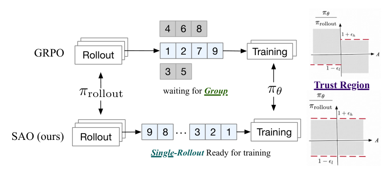
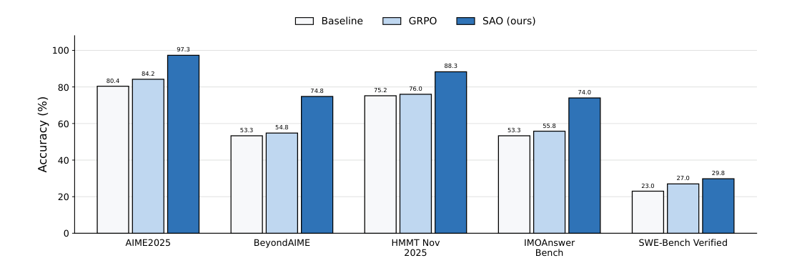
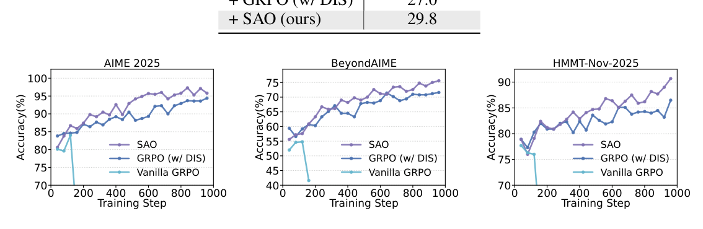
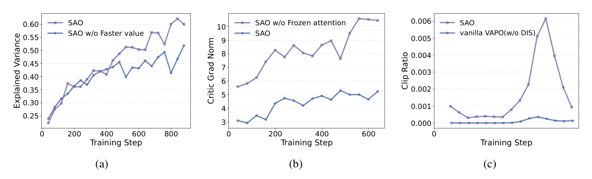

# SAO（全称：Single-Rollout Asynchronous Optimization for Agentic Reinforcement Learning）

> **一句话本质**：SAO 用单 rollout 采样替代组采样消除长时程智能体异步训练的木桶等待瓶颈，配合冻结注意力的强 Critic、Skip-Observation GAE 与双侧硬门控裁剪（DIS），实现兼顾吞吐与千步稳训的智能体异步强化学习。
>
> 作者/机构：Zhenyu Hou, Yujiang Li, Jie Tang, Yuxiao Dong ｜ 清华大学, Z.AI ｜ 年份：2026 ｜ 原文：Zotero 锚点（见下行）或 [arXiv:2607.07508](https://arxiv.org/abs/2607.07508) ｜ 入库：2026-10-30
> Zotero：[Hou2026](zotero://select/items/@Hou2026) `Hou2026` ｜ [P25H254B](zotero://select/items/P25H254B) `P25H254B` ｜ [DOI](https://doi.org/10.48550/arXiv.2607.07508) `10.48550/arXiv.2607.07508`

## 五分钟重建

  
GRPO 的组采样在长时程多轮智能体任务中面临严重的木桶等待瓶颈与版本交叉污染，而异步更新又常因策略滞后（Policy Lag）在百余步内迅速崩溃。SAO 废弃组采样，改用单轨迹即采即训，并引入双侧硬裁剪抵御离线偏差。

  <ol class="guide-path" aria-label="机制路径">
    <li><h3>单轨迹异步回传</h3>
每个 Prompt 仅生成一条轨迹（$G=1$），推理引擎逐 Token 记录行为概率 $\log \pi_{\text{rollout}}$，轨迹一旦完成立即回传训练队列，无需等待整组其他样本。
</li>
    <li><h3>双频强价值估计</h3>
Critic 预先在大规模回报数据上预训练冷启动，冻结自注意力层仅微调 MoE 参数，并以 $K=2$ 倍于策略的频率快更新；跨过环境反馈 Token 计算 Skip-Observation GAE。
</li>
    <li><h3>双侧硬门控更新</h3>
计算当前策略与生成时行为概率的比值 $r_t(\theta)$；若落在非对称宽信任区间 $[1-\epsilon_l, 1+\epsilon_h]$ 内则正常更新，一旦越界直接硬置零阻断梯度，避免陈旧轨迹毁坏模型。
</li>
  </ol>
  
<strong>具体例子（教学假设）</strong>：一条异步回传的轨迹中，某个 Token 经过若干步参数迭代后，概率比值漂移为 $r_t = 8.0$（$\epsilon_h = 5.0$）。在标准 PPO 下该 Token 被软截断为 $1+\epsilon$ 依然推动正向更新；而在 SAO 中由于 $8.0 > 1+5.0$，该 Token 门控直接置零，不产生任何梯度污染。

  
<strong>边界</strong>：依赖高并发推理引擎提供逐 Token 的生成对数概率；需要额外维护独立的 Critic 模型（显存开销与 PPO 相当，高于 GRPO）；若 Critic 缺乏充分的回报预训练冷启动，单 Rollout 的高方差会导致收敛困难。

  

    <h3>换个条件看机制</h3>
    
如果去除 Skip-Observation 设计，把终端返回的 500 行编译器报错也纳入 GAE 链条计算，会发生什么？

    
Critic 会被迫尝试去预测外部随机环境的状态转移价值，导致优势估计被无关的环境噪声严重污染，破坏模型自身动作的信用分配。

  

  <aside class="guide-selftest"><h3>可选自测</h3>
关掉提示后解释：为什么单 Rollout 的单题方差明显大于组采样，在固定训练时间内却能在复杂推理基准上全面反超 GRPO？
</aside>
  
2026-10-30：讲解与练习待试用，本次未进行理解检验；此处不记录复测通过。

## 论文图解

*图 1 费曼图解（论文 Figure 2）：GRPO 在异步系统中必须等待同一 Prompt 的整组样本就绪（Waiting for Group），存在严重的木桶等待与跨版本混杂；SAO 采用单 Rollout 设计，每条轨迹生成完毕立即送入训练队列（Ready for Training），消除同步屏障并通过 DIS 限制在信任域内。*

*图 2 费曼图解（论文 Figure 1）：在 Qwen3-30B-A3B 骨干上，SAO 在 AIME2025（97.3% vs 84.2%）、BeyondAIME（74.8% vs 54.8%）、IMOAnswerBench（74.0% vs 55.8%）与 SWE-Bench Verified（29.8% vs 23.0%）等长时程基准上全面大幅超越同步 GRPO 基线。*

*图 3 费曼图解（论文 Figure 3）：在 AIME2025、BeyondAIME 与 HMMT 训练步进曲线中，Vanilla GRPO 在约 160 步发生灾难性崩溃（Collapse）；GRPO (w/ DIS) 虽维持稳定但在 400 步后停滞；SAO 凭借单 Rollout 更高的样本多样性持续攀升，稳定训练超 1000 步。*

*图 4 费曼图解（论文 Figure 4）：(a) 更快价值更新（$K=2$）显著提高 Critic 的解释方差（Explained Variance）；(b) 冻结注意力层（Frozen Attention）将 Critic 梯度范数压制在低位平稳区间，全参数训练则发生梯度激增；(c) DIS 的 Token 级裁剪率稳定在千分之几，从根源上剔除发散更新。*

## 解决什么问题

在长时程大模型智能体（如多轮 Python 工具调用、SWE-Bench 交互式代码修 Bug）的强化学习后训练中，传统的同步与组相对算法面临三重困境：

1. **组采样在异步系统中的木桶同步屏障（Straggler 瓶颈与 Prompt 饥饿）**：
   - [GRPO](2024-deepseekmath.md) 依赖组内比较（同题生成 $G \ge 8$ 条回答计算均值与方差），省去了独立 Critic；
   - 智能体多轮交互的轨迹长度高度长尾（短的几步报错，长的几十轮交互达 128k Token）；
   - 在异步推理/训练集群中，若强行等同一题的一组轨迹收齐，快节点长期闲置等待慢节点，造成巨大的硬件算力浪费；同时在固定的计算预算下，模型见到的 Prompt 种类被压缩为原来的 $1/G$，严重缺乏探索多样性。
2. **异步流水线的策略滞后（Policy Lag）引发毁灭性模型崩溃**：
   - 异步系统的核心优势是「即采即训」的高吞吐，但一条几十轮的长轨迹回传到训练端时，主模型参数往往已更新了若干步，数据呈现严重的 Off-policy 特征；
   - 标准 [PPO](2017-ppo.md) 与 VAPO 依赖旧策略模型 $\pi_{\theta_{\text{old}}}$，在异步集群中动态维护旧模型快照集合在工程上不可行；若使用单版本强行近似，离散分布累积偏差会瞬间摧毁优化，论文实测 Vanilla GRPO 约 160 步崩溃，Vanilla VAPO 约 90 步崩溃。
3. **环境反馈 Token 污染信用分配（Credit Assignment）**：
   - 智能体轨迹中交织着模型动作与环境回包：$[a_0, o_0, a_1, o_1, \dots]$；
   - 终端返回的几百行错误堆栈并非模型产生，而是外部环境的客观反馈。标准 GAE 对轨迹内所有 Token 顺次做时序差分，迫使价值网络去拟合不可控的环境随机性，造成状态价值估计与优势计算严重失真。

## 大白话讲解

### 类比：专职考官独立巡考 vs 8 人组队跳水集体打分

- **GRPO 的做法（集体跳水打分）**：
  必须等同一个代表队的 8 位队员全跳完，算这 8 个人的平均成绩作为打分基准。如果某位队员因为动作复杂花了 20 分钟才完成，全场裁判和所有其他泳道的选手都得在池边干冻着等；等最后一名队员跳完，前面几位队员的表现由于隔了太久，甚至已经属于「上个赛季的模型水平」，导致组内横向比较在逻辑上彻底错乱。
- **SAO 的做法（专职考官独立巡考）**：
  每位选手（Prompt）只跳一次（$G=1$），跳完立刻由场边经验极度老练的专职考官（提前经过大规模预训练、且冻结了注意力的 Critic）进行专业评定，毫不停顿。
  针对录像回传延迟（异步导致的策略滞后），SAO 采取了极其干脆的「双侧硬门控」机制：考官比对选手动作发生时的录像概率与当前队伍的风格。如果发现某个动作已经严重脱节（比值超出安全信任域），**考官直接把这几个动作在成绩单上涂黑置零，完全不产生打分影响**。

在异步长时程任务中，最关键的矛盾不是「单道题方差大」，而是「见过的题太少」与「陈旧数据把模型带歪」。SAO 依靠强大的专职考官抹平了单题方差，同时让模型见到的题目数量提升了近一个数量级；偶有脱节的动作宁可不学、直接扔掉，换来了稳定训练上千步的极致鲁棒性。

## 关键机制

### 1. 单 Rollout 异步生成流水线（Single-Rollout Pipeline, $G=1$）
- 彻底废除组采样机制。每个 Prompt 仅在异步推理引擎上生成一条轨迹；
- 推理引擎在解码过程中，原生地记录每个 Token 的行为概率 $\log \pi_{\text{rollout}}(a_t \mid s_t)$，并随轨迹一并传回训练队列；
- 训练端随到随训，消除了任何跨样本的同步屏障，使 Prompt 探索覆盖率最大化。

### 2. 强价值网络设计与双频更新（Frozen-Attention Critic + TTUR）
既然放弃了组内均值，单 Rollout 必须依靠高质量的状态价值估计 $V_\phi$ 提供低方差基线：
- **冷启动回报预训练**：Critic 模型在 SFT 阶段即在大规模语料上进行回报回归预训练（以拟合真实 Return），解决初始价值估计方差过大的问题；
- **冻结自注意力层（Frozen Attention）**：Critic 冻结全部 Full Attention 层，仅微调 MoE / FFN 与 Value Head 参数。这一设计牢牢锁住了 Critic 梯度的范数（如图 4b 所示），防止价值网络在训练中剧烈发散；
- **双频更新（Two Time-scale Update Rule, $K=2$）**：策略网络每更新 1 次，Critic 网络先行迭代更新 2 次，确保价值估计始终贴近最新的策略分布回报。

### 3. 跳过环境观测的优势估计（Skip-Observation Token-level GAE）
智能体多轮轨迹结构为 $\mathcal{T} = [a_0, o_0, a_1, o_1, \dots]$。环境观测 $o_i$ 的 Token 由外界产生，不应参与策略反向传播与价值链条：
- 价值模型仅在模型自身的动作 Token 上评估；
- 在动作与动作的时序边界上，Bellman 备份直接跨过观测区间：令 $a_{i,N}$ 为第 $i$ 轮动作末尾 Token，$a_{i+1,0}$ 为下一轮动作首 Token：
  $$\delta = r_t + \gamma V(a_{i+1,0}) - V(a_{i,N})$$
  $$\hat{A}(a_{i,N}) = \delta + \gamma\lambda\,\hat{A}(a_{i+1,0})$$
- 动作内部 Token 采用长度自适应 GAE 计算（$\lambda_{\text{policy}} = 1 - \frac{1}{\alpha l}$，$\alpha=1.5$）。环境噪声被物理隔离，保证信用精准分配到动作决策上。

### 4. 直接双侧重要性采样与硬门控（Direct Bilateral Importance Sampling, DIS）
传统 PPO 需要加载历史检查点评估 $\pi_{\theta_{\text{old}}}$，在异步流水线中成本极高。DIS 直接计算当前策略与生成时行为对数概率的比值：

$$r_t(\theta) = \exp\big(\log \pi_\theta(a_t \mid s_t) - \log \pi_{\text{rollout}}(a_t \mid s_t)\big)$$

策略优化目标定义为带硬门控的双侧函数：

$$\mathcal{L}(\theta) = \hat{\mathbb{E}}_t\left[ f\big(r_t(\theta), \epsilon_l, \epsilon_h\big) \cdot \hat{A}_t \cdot \log \pi_\theta(a_t \mid s_t) \right]$$

校准函数 $f$ 采用双侧硬门控（Hard Masking）：

$$f(x, \epsilon_l, \epsilon_h) = \begin{cases} x, & \text{若 } 1 - \epsilon_l < x < 1 + \epsilon_h \\ 0, & \text{其他} \end{cases}$$

- **与 PPO 软截断的根本不同**：PPO 在 $r_t > 1+\epsilon$ 时强制将系数设为 $1+\epsilon$（依然提供同向梯度推进）；DIS 认为一旦策略偏离超出安全边界，该 Token 的行为逻辑已被当前模型大幅修改，强行更新极易带来毁灭性破坏，因此**直接硬性置零阻断梯度**；
- **非对称宽信任域**：实验设定 $\epsilon_l \in [0.3, 0.8]$，$\epsilon_h \in [3.0, 5.0]$，给予低概率生成方向更宽容的探索空间，同时严格斩断高概率发散更新。

## 结果与代价

- **基准测试全面领先**：在 Qwen3-30B-A3B-Thinking 骨干下：
  - AIME2025 达到 97.3%（超越 GPT-5 High 的 94.6%，显著优于 GRPO 的 84.2% 与 GRPO w/ DIS 的 93.5%）；
  - BeyondAIME 达到 74.8%（GRPO 仅 54.8%）；
  - IMOAnswerBench 达到 74.0%（GRPO 仅 55.8%）；
  - SWE-Bench Verified 达到 29.8%（基线 23.0%，GRPO w/ DIS 27.0%）。
- **千步极限稳训**：Vanilla GRPO 在 160 步左右发生崩溃，Vanilla VAPO 在 90 步崩溃；SAO 保持平稳收敛超过 1000 步，被裁剪的 Token 比例始终稳定在极低区间（千分之几）。
- **非平稳在线学习环境下的快速适应**：在语言风格偏好动态切换（Cute $\to$ Chuunibyou $\to$ Classical）的模拟在线实验中，SAO 凭借单 Rollout 的即时反馈，在新分布到来后迅速重对齐，而传统依赖滑窗均值的基线产生了严重的适应滞后。
- **工业级实证**：已成功部署于开源 750B-A40B 大模型 **GLM-5.2** 的智能体 RL 训练流水线。
- **代价与局限**：
  1. **显存成本**：恢复了独立的 Critic 模型，显存开销与标准 PPO 一致（约为 GRPO 的两倍）；
  2. **冷启动依赖**：若缺乏高质量回报数据的 Critic 预训练，单 Rollout 容易因初始价值偏差过大而退化为高方差的 REINFORCE；
  3. **基础设施侵入**：依赖推理引擎原生输出逐 Token 的采样对数概率（$\log \pi_{\text{rollout}}$）。

## AI 预读备注

本篇预读底稿提取自 Zotero AI Butler 子项（itemKey：`ATCLW9GW`，GLM-5.3 引擎，生成于 2026-08-24）。
- **预读提取的核心线索**：准确梳理了单 Rollout 采样、DIS 双侧硬门控、Skip-Obs GAE 与 Frozen-Attention Critic 四大模块；
- **人工校验与费曼深化**：AI Butler 摘要将 DIS 简述为「裁剪策略」，但在费曼检验中我们深入辨析了它与 PPO 截断的本质差异——DIS 是硬门控置零（Gradient Masking）而非数值饱和社会，这也是异步离线偏差下避免模型崩塌的核心数学保障。

## 我的复述

<!-- 费曼检验时 XinLi 自己的话，保留原味，不润色 -->

- **关于为什么放弃 GRPO 请回 Critic（检验题 1）**：
  > “因为 SAO 采用单个 rollout 而不是一组多个 rollout，需要通过高质量的 critic 网络抑制掉单轨迹的方差影响；如果坚持 GRPO 组采样，每个 prompt 都需要等到整组里面最长的 rollout 完成才能进行模型更新，导致有限资源下模型见到的 prompt 数量太少多样性不够。”
- **关于 DIS 双侧硬门控与 PPO 截断的差异（检验题 2）**：
  > “1. 按 PPO 标准，概率比值大于了 1+\epsilon ， 会被截断为 1+\epsilon，此时该 token 依然提供正向梯度推动 2. 按照 SAO DIS 做法，这种情况直接被截断，梯度为 0 ； 3. 因为在异步系统中面临的核心矛盾不是单题方差大而是见过的问题太少与等待长尾造成的数据过期， 而 DIS 把明显坏掉的轨迹丢掉避免模型被带崩，SAO 不用整组大量prompt等待，相比 GRPO 这类能见到更多的 prompt 丢掉小部分轨迹影响不大。”
- **关于 Skip-Observation GAE 的必要性（检验题 3）**：
  > “模型会尝试去预测外部环境的反馈，因为不跨过的话模型会尝试去拟合外部环境的反馈token”

## 卡壳点与解答

  
Q：DIS 的双侧硬门控和 PPO 的 Clip 截断到底有什么本质区别？为什么异步下必须置零？

  

PPO 的 Clip 是「饱和截断」：当比值越界时，强行以边界值 $1+\epsilon$ 计算，梯度依然存在且持续推动更新。在同步同分布下这能提供稳定的保守更新；但在异步集群中，严重越界的比值代表数据产生自极为陈旧的模型快照，该动作在当前策略下已经被认定为不可信。若继续以 $1+\epsilon$ 强推，累积的 Off-policy 伪梯度会在百余步内直接撕裂分布。DIS 采取硬门控置零（$f=0$），直接关闭该 Token 的梯度流，宁可不学、绝不学歪。

  
Q：单 Rollout 的单题方差天然高于组采样，为什么长时程智能体整体训练效果反而大幅超越 GRPO？

  

长时程多轮智能体任务在固定算力预算下的核心矛盾是「木桶等待造成的算力空转」与「Prompt 覆盖多样性严重匮乏」。GRPO 同一题采 8 条，不仅导致快节点苦等慢节点，而且见到的题目种类只有 $1/8$。SAO 凭借预训练充分且冻结注意力的 Critic 吸收掉了单题方差，同时将 Prompt 探索空间拓宽了 8 倍，因而在复杂推理与工程编码等考验知识广度与深度探索的基准上达成全面领先。

  
Q：智能体多轮轨迹中的环境观测（Terminal 输出）为什么不能顺次参与 GAE 时序差分？

  

外部观测 Token（例如 500 行编译器报错或 Bash 执行结果）并非模型策略 $\pi_\theta$ 生成，其文本分布由外部编译器、解释器或沙盒物理环境决定。若不跨过这些 Token，Critic 网络会强行去建模外部环境的状态转移概率，导致时序差分误差被外界随机性严重污染，无法为模型前后的真实动作进行正确的信用分配。

## 还没搞懂

- 待探索：在长时程多轮智能体中，Critic 网络是否可能通过与 Policy 参数浅层共享或 LoRA 微调来降低显存开销，而无需完全保留独立的对等规模网络？
- 待验证：DIS 的非对称裁剪阈值（$\epsilon_l=0.3 \sim 0.8, \epsilon_h=3.0 \sim 5.0$）在非 MoE 架构（Dense 模型）或连续状态控制智能体任务上的普适性与灵敏度规律。

## 关联

- [DeepSeekMath / GRPO](2024-deepseekmath.md) — GRPO 靠组内均值消灭了独立 Critic，在短推理与同步训练下极其高效；SAO 揭示了其在异步长时程智能体任务下的木桶同步瓶颈与非平稳失效，重新证明了独立强 Critic 的必要性。
- [PPO](2017-ppo.md) — SAO 继承了 Actor-Critic 范式与 GAE 优势估计，但将 PPO 的三模型结构与软截断改写为基于推理端行为概率的单 Rollout 双侧硬门控（DIS）。
- [GSPO](2025-gspo.md) — GSPO 从序列级长度归一化似然解决 MoE 路由跳变与逐 Token 撕裂；SAO 则从系统异步性与智能体长轨迹出发，通过单 Rollout 与 DIS 实现高吞吐千步稳训。
